# Coparticipación federal: el caso de Córdoba

[](https://github.com/llorenzomagnano-sys/analisis-de-la-coparticipacion-federal-con-foco-en-cordoba/actions/workflows/ci.yml)

Análisis de datos del régimen de coparticipación federal de impuestos en Argentina, con foco en la provincia de Córdoba.

## Sobre este proyecto

La coparticipación federal es uno de esos temas que aparecen todo el tiempo en la agenda económica argentina — un gobernador reclamando por su provincia, un cambio de coeficientes generando discusión — pero que casi nunca se explican con números concretos y trazables. Armé este repositorio para entender mejor cómo funciona el reparto de la Ley 23.548 en la práctica, tomando a Córdoba como caso de estudio en vez de quedarme en generalidades sobre todo el país.

Lo organicé en cuatro preguntas que se van encadenando: cómo evolucionó en el tiempo la coparticipación real que recibe Córdoba, si la provincia recibe en proporción a lo que aporta, qué tan sensible es ese reparto a un shock de recaudación, y qué tan dependiente es el presupuesto provincial de esa plata. Una quinta parte pone a Córdoba en contexto y compara a las 24 jurisdicciones entre sí. De dónde sale cada dato, qué supuestos tomé y dónde flaquean queda documentado a la vista en vez de escondido en un anexo — es la parte del trabajo que más tiempo me llevó.

## Principales hallazgos

- **Serie histórica (2003-2025)**: la coparticipación real de Córdoba (en pesos de 2025) llegó a un máximo de $5,42 billones en 2022 y cerró 2025 en $4,74 billones, más o menos el nivel de 2016. Contra 2003 es 3,1 veces más, pero ese número exagera: 2003 es el piso de la crisis (solo en 2004 la serie subió 50% real). Desde 2004 creció 2,1 veces, y por habitante, 1,6 veces; por habitante, Córdoba tuvo su máximo en 2018 y en 2025 está 17% por debajo.
- **En proporción a la economía y a la población**: para las 24 jurisdicciones juntas, la coparticipación pasó de 4,9% del PIB en 2004 a 6,7% en 2025, y por habitante creció 1,68 veces. La descomposición de ese crecimiento: el PIB real explica ×1,53, una recaudación coparticipable más alta en relación al PIB ×1,26 y una parte más grande de esa masa para las provincias ×1,09 (sobre todo por la devolución del 15% que se detraía para la ANSES). No hay ilusión monetaria: deflactada con el deflactor del PIB en vez del IPC, la serie da prácticamente lo mismo.
- **Aporte vs. recibo por provincia**: comparando la porción de cada provincia en lo que se reparte entre provincias con su peso en el PBG, Córdoba queda prácticamente empatada: recibe el 8,58% del reparto y representa el 8,57% del PBG. Las que quedan claramente por debajo son CABA (−17,5 pp), Buenos Aires (−10,7 pp) y Neuquén (−2,7 pp); las que más reciben en relación a su PBG, Chaco, Formosa y Tucumán (cerca de +3 pp cada una). Eso mide cuánto redistribuye el régimen, que está diseñado para eso, no si el reparto es justo. Y Córdoba es neutral dentro de la coparticipación, pero no frente a la Nación: las retenciones sobre su producción, que no se coparticipan, equivalen según mi estimación al 31% de su coparticipación en 2024 (23% con una cota baja), y llegaron a superarla en 2008.
- **Simulador de sensibilidad**: calibrado con la caída de recaudación de comienzos de 2026 que dio a conocer IARAF, una baja de ~6,3% en la recaudación nacional coparticipable le cuesta a Córdoba unos $120.100 millones en un cuatrimestre. Contra lo que Córdoba efectivamente cobró en enero-abril de 2026 (−7,3% real, unos $134.100 millones menos), el modelo acierta el orden de magnitud y subestima la pérdida en alrededor de 10%. Como el reparto es proporcional, todas las provincias pierden el mismo porcentaje de lo que les corresponde; lo que cambia la gravedad del golpe es cuánto depende cada una de la coparticipación (Núcleo 4).
- **Dependencia fiscal de Córdoba (2015-2025)**: la coparticipación pasó de explicar el 52,0% de la recaudación total de Córdoba (recursos propios que administra Rentas más recursos de origen nacional) en 2015 a un máximo de 57,6% en 2023, y bajó a 53,1% en 2025. En pesos constantes, la suba se explica sobre todo por la recaudación propia, que cayó un 20% entre 2017 y 2020 y se mantuvo cerca de ese piso hasta 2024, mientras la coparticipación se recuperaba. Con la dependencia de 2025, una caída del 10% en la recaudación nacional coparticipable reduce esa recaudación total en un 5,2%. Contra las demás provincias, con la ejecución presupuestaria de las 24 (Ministerio de Economía), Córdoba es de las menos dependientes: en 2025 las transferencias nacionales fueron el 52,4% de sus ingresos (sin contribuciones a la seguridad social), sexta de 23 jurisdicciones con datos, contra una mediana de 66% y más de 80% en La Rioja, Chaco, Formosa, Corrientes y Catamarca. En 2005 eran el 66,9%.
- **Las 24 jurisdicciones comparadas**: como los coeficientes son fijos, el monto real de 22 de las 24 creció casi igual desde 2004 (entre ×2,07 y ×2,14). Por habitante, en cambio, el crecimiento va de ×1,10 en Tierra del Fuego a ×1,98 en CABA, y lo decide casi por completo cuánto creció la población de cada una (correlación de rangos de −0,98): la ley no tiene ningún componente que siga a la población. Córdoba: ×1,62. Los movimientos grandes del reparto vienen de cambios de reglas: el Fondo del Conurbano congelado hasta 2017 le hizo perder a Buenos Aires 5 puntos del reparto, que recuperó con el Consenso Fiscal, y CABA pasó de 2% a más de 5% del reparto entre 2016 y 2020. Sin la compensación del Consenso Fiscal, cada jurisdicción recibe hoy prácticamente su coeficiente legal. Esa compensación va en un 56% a Buenos Aires, y por eso Córdoba recibe 0,29 puntos menos que su coeficiente: unos $157.100 millones en 2025, si se hubiera repartido según los coeficientes.
- **Por habitante (Censo 2022)**: las diferencias son mucho mayores. Tierra del Fuego y Catamarca reciben casi tres veces el promedio de las 24 y Buenos Aires y CABA bastante menos (0,59 y 0,34 veces): cuanto menos población, más coparticipación por habitante. Córdoba queda justo en el promedio, unos $1,41 millones por habitante en 2022 (en pesos de 2025). Junto con el Núcleo 2, es neutral dentro de la coparticipación.

## Núcleos de análisis

| Núcleo | Descripción | Notebook |
|---|---|---|
| 1 | Serie histórica de coparticipación (2003-2025) | [`01_serie_historica.ipynb`](notebooks/01_serie_historica.ipynb) |
| 2 | Aporte vs. recibo por provincia | [`02_aporte_vs_recibo.ipynb`](notebooks/02_aporte_vs_recibo.ipynb) |
| 3 | Simulador de sensibilidad | [`03_simulador_sensibilidad.ipynb`](notebooks/03_simulador_sensibilidad.ipynb) |
| 4 | Peso de la coparticipación en las cuentas de Córdoba | [`04_dependencia_fiscal_cordoba.ipynb`](notebooks/04_dependencia_fiscal_cordoba.ipynb) |
| 5 | Las 24 jurisdicciones comparadas | [`05_comparacion_provincias.ipynb`](notebooks/05_comparacion_provincias.ipynb) |

La metodología completa — fuentes, supuestos y limitaciones de cada núcleo — está en [`docs/methodology.md`](docs/methodology.md).

### Núcleo 1 — Serie histórica de coparticipación

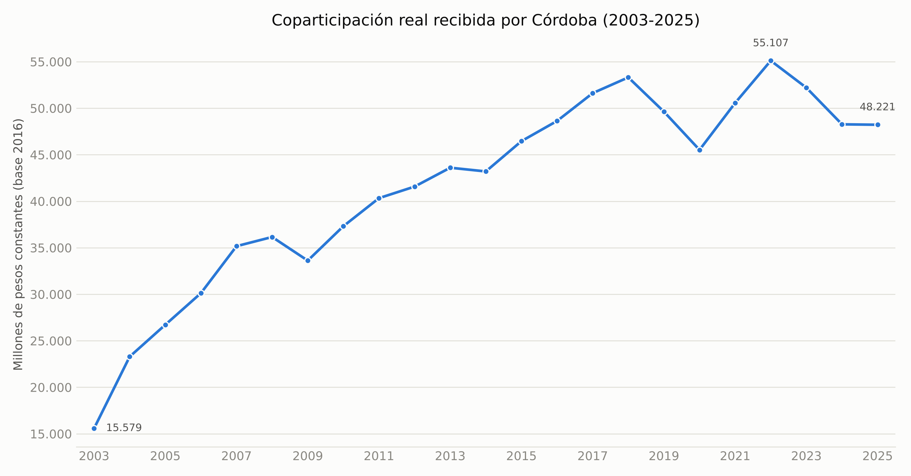

En niveles absolutos Buenos Aires tapa todo por su tamaño. Por habitante, el orden se invierte:

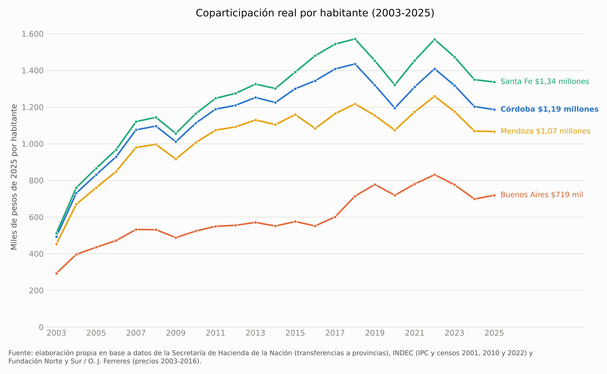

Y para saber si eso es mucho o poco, el total de las 24 por habitante y como % del PIB:

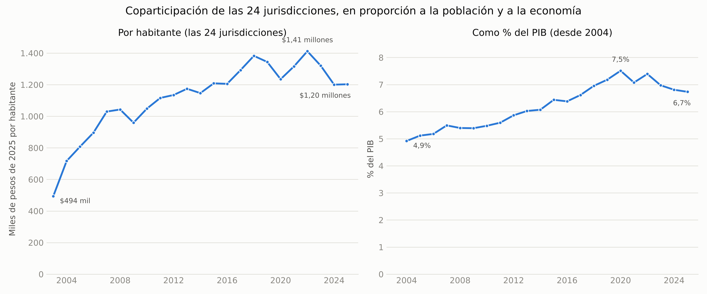

### Núcleo 2 — Aporte vs. recibo por provincia

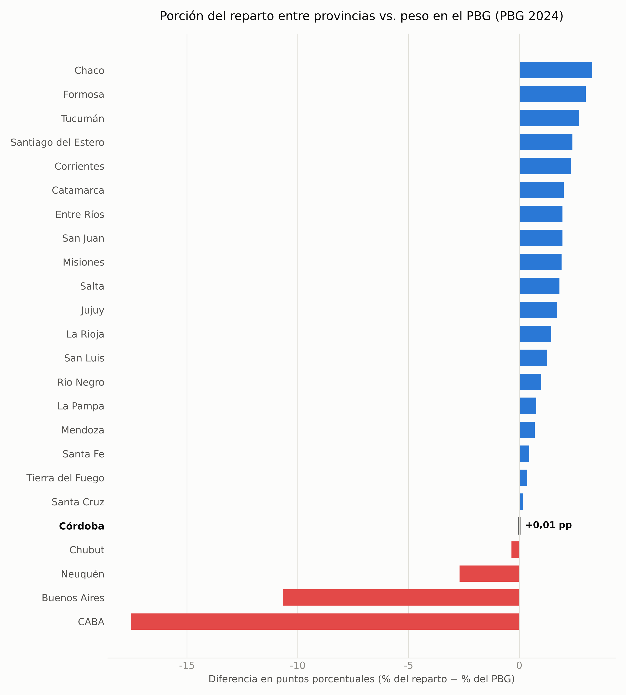

Lo que esa comparación no ve: las retenciones, que no se coparticipan. Estimadas según el peso de Córdoba en las exportaciones agropecuarias, son del mismo orden de magnitud que la coparticipación que recibe la provincia:

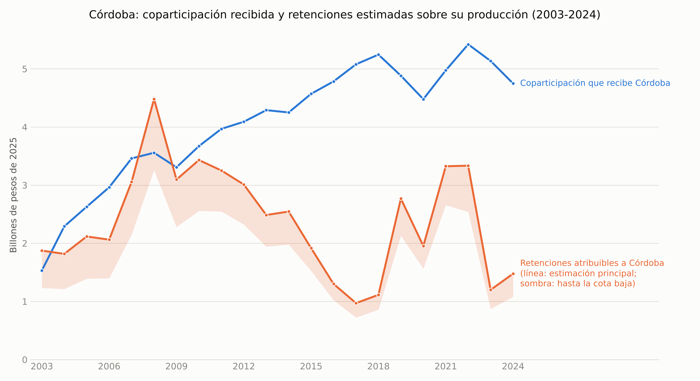

### Núcleo 3 — Simulador de sensibilidad

Impacto en pesos del escenario de comienzos de 2026. En porcentaje, todas las provincias pierden lo mismo, porque el reparto es proporcional al coeficiente:

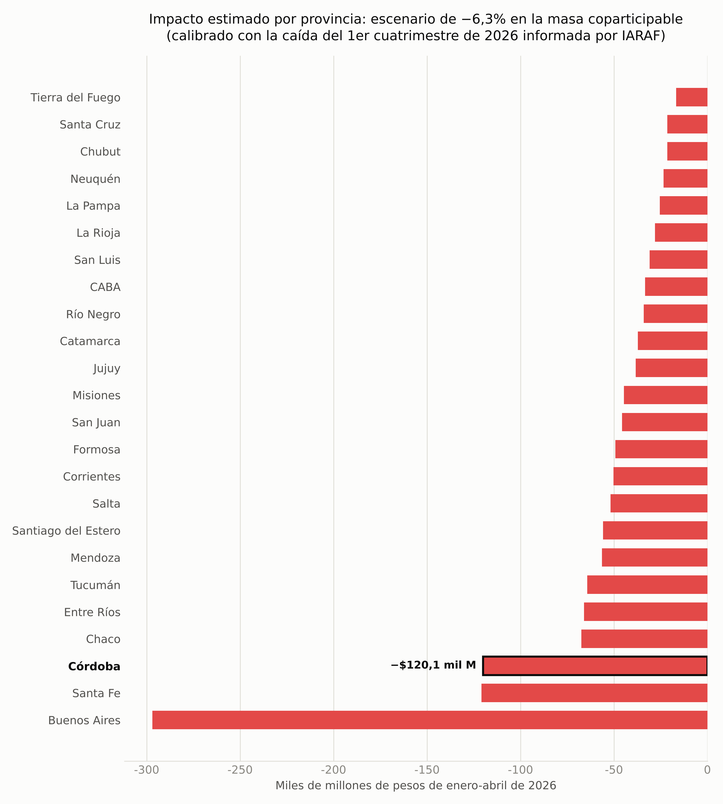

Demo del simulador recorriendo distintos escenarios de shock, con el impacto como % de la recaudación total de Córdoba (generada con `scripts/build_demo_gif.py`):

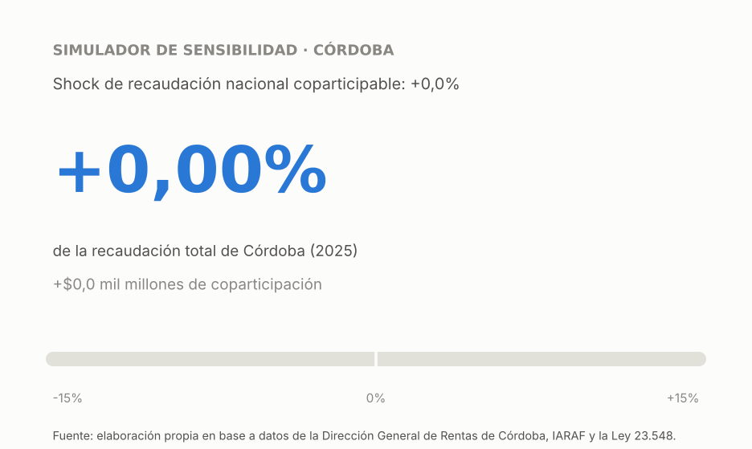

**[Probar el simulador en el navegador →](https://llorenzomagnano-sys.github.io/analisis-de-la-coparticipacion-federal-con-foco-en-cordoba/simulador/)**: misma fórmula de `simular_shock`, reimplementada en JavaScript en una página estática (`docs/simulador/index.html`). Usa los datos de 2025 de este repositorio; el detalle con las 24 jurisdicciones está en el notebook.

### Núcleo 4 — Peso de la coparticipación en las cuentas de Córdoba

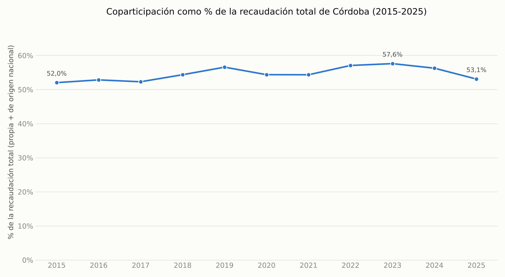

El ratio da igual en pesos nominales o reales; para ver por qué se movió hay que mirar los niveles en pesos constantes. La recaudación propia se estancó justo cuando la coparticipación crecía:

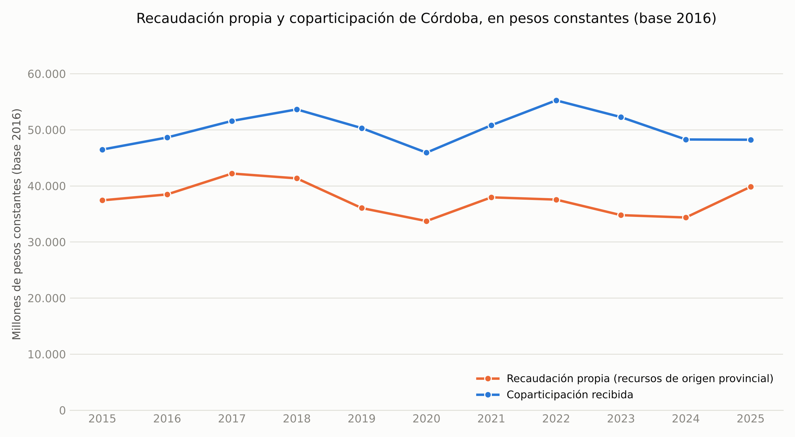

Contra las demás jurisdicciones, con la ejecución presupuestaria de cada una (sin las contribuciones a la seguridad social, que solo registran las provincias con caja de jubilaciones propia):

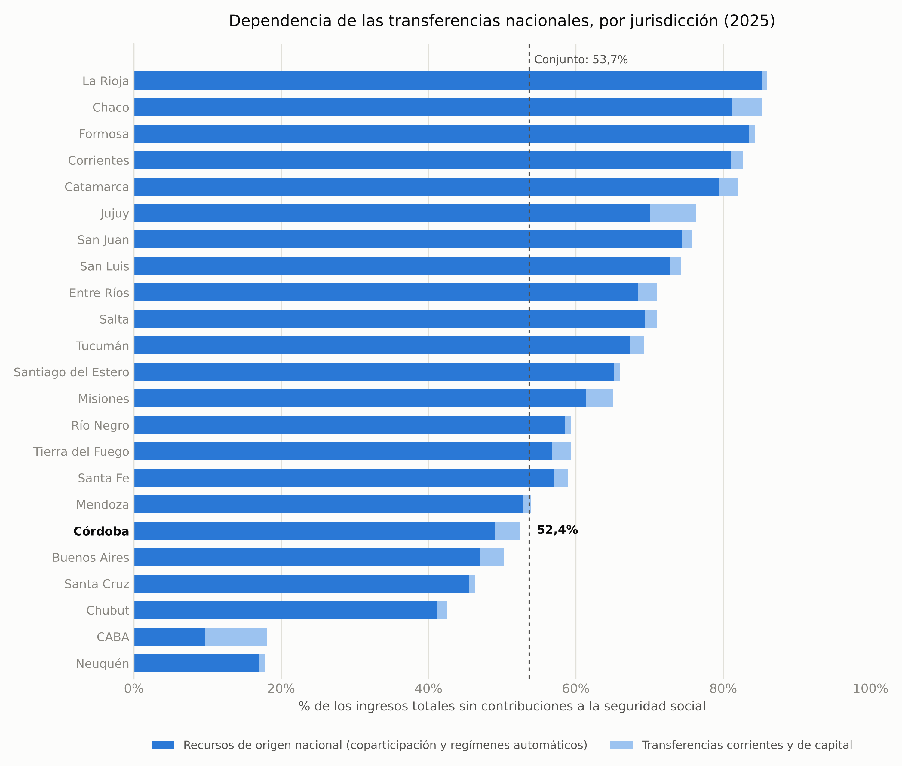

### Núcleo 5 — Las 24 jurisdicciones comparadas

Con coeficientes fijos, el monto de todas crece casi igual, así que lo que separa a unas de otras por habitante es cuánto creció su población:

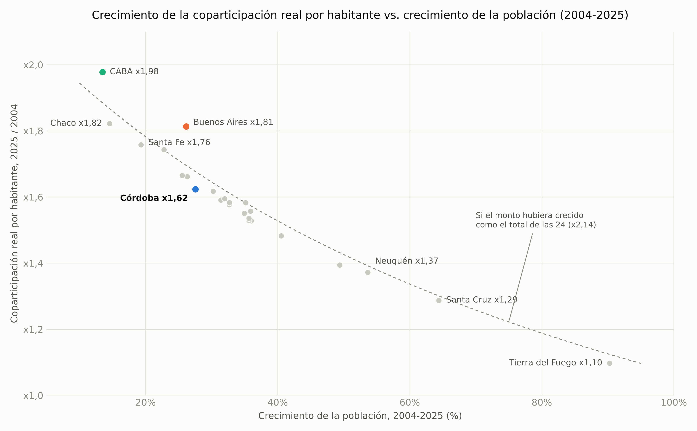

Los cambios en la porción de cada una vienen de cambios de reglas puntuales: el Fondo del Conurbano congelado (Buenos Aires), el Decreto 194/2016 y la Ley 27.606 (CABA), y el Consenso Fiscal de 2018:

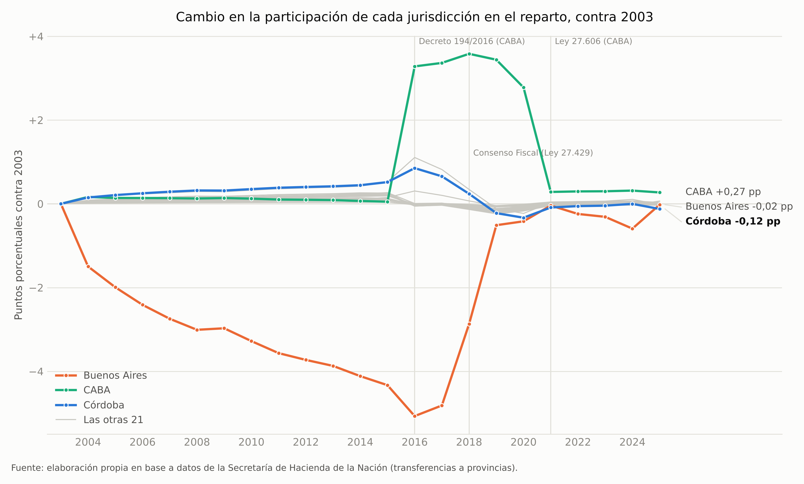

Por habitante, con la población del Censo 2022, la foto cambia: las jurisdicciones chicas reciben mucho más que el promedio, y Córdoba queda justo en él:

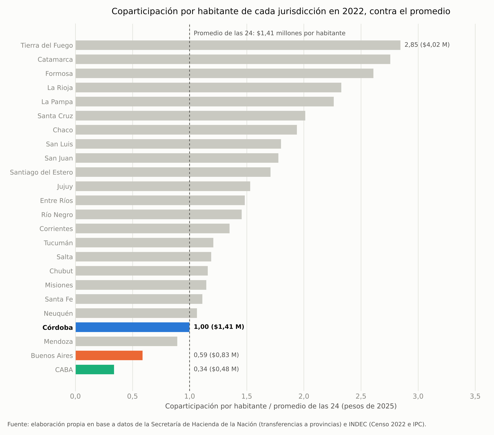

## Simulador interactivo

El Núcleo 3 tiene un simulador interactivo (slider de `ipywidgets`) dentro de `notebooks/03_simulador_sensibilidad.ipynb`, más la versión web linkeada arriba. Elegí `ipywidgets` en vez de una app Streamlit para que todo el proyecto se pudiera reproducir desde los notebooks sin depender de un servidor; la lógica (`scripts/simulator.py`) está separada y sin dependencias de notebook, así que la versión web es solo esa misma fórmula en JavaScript.

## Estructura del repositorio

```
data/raw/          # Datos crudos, tal como se obtuvieron. Nunca se editan a mano.
data/processed/    # Datos limpios, generados por los scripts de scripts/.
scripts/           # Procesamiento de cada núcleo, simulador y tests (simulador + consistencia de datos).
notebooks/         # Un notebook por núcleo temático, con los gráficos e interpretación.
docs/              # Metodología, y el simulador web (docs/simulador/, publicado con GitHub Pages).
output/figures/    # Gráficos exportados (PNG), embebidos en este README y en los notebooks.
run_all.py         # Corre todo el pipeline de procesamiento + notebooks con un solo comando.
```

## Fuentes de datos

| Fuente | Organismo | Núcleo(s) |
|---|---|---|
| [Coparticipación / Recursos de Origen Nacional (RON)](https://www.argentina.gob.ar/economia/sechacienda/asuntosprovinciales/ron) | Secretaría de Hacienda, Ministerio de Economía de la Nación | 1, 3, 4, 5 |
| [Índice de Precios al Consumidor, 2016-2025](https://www.indec.gob.ar/ftp/cuadros/economia/serie_ipc_divisiones.csv) | INDEC | 1 |
| Índice de Precios al Consumidor, 2003-2015 (archivo obtenido en forma directa, sin URL pública verificada; en el repo solo las tasas usadas) | Fundación Norte y Sur / Orlando J. Ferreres | 1 |
| Producto Bruto Geográfico por provincia (`Jurisdiccion_52sectores.xlsx`, descargado a mano, sin URL verificada) | CEPAL, sobre metodología base de INDEC | 2 |
| Índices de distribución de la coparticipación federal (`indices_copa_2018.pdf`, planilla de febrero de 2018, descargada a mano) | No figura en el documento (menciona instrucciones de la Secretaría de Hacienda al BNA) | 2, 3, 4, 5 |
| Recaudación provincial (`serie_recaudacion_provincial.xlsx`, sin URL pública estable) | Dirección General de Rentas de Córdoba | 4 |
| [Caída de la recaudación nacional en el primer cuatrimestre de 2026](https://www.iaraf.org/index.php/13-areas-de-estudio/area-fiscal/723-informe-economico-2026-05-05) (escenario de referencia del simulador) | IARAF | 3 |
| [Población por jurisdicción, Censo 2022 (resultados definitivos)](https://www.indec.gob.ar/ftp/cuadros/poblacion/c2022_tp_est_c1.xlsx) | INDEC | 1, 5 |
| [Población por provincia 2001 y 2010 (Censo 2010, Tomo 1, Cuadro 8; transcripta)](https://www.indec.gob.ar/ftp/cuadros/poblacion/censo2010_tomo1.pdf) | INDEC | 1, 5 |
| [PIB nominal y a precios de 2004 (oferta y demanda globales)](https://www.indec.gob.ar/ftp/cuadros/economia/sh_oferta_demanda_09_26.xls) | INDEC | 1 |
| [Ejecución presupuestaria provincial, esquema ahorro-inversión 2005-2025](https://www.argentina.gob.ar/sites/default/files/serie_aif-apnf-2025.xlsx) | Dirección Nacional de Coordinación Fiscal con las Provincias, Ministerio de Economía | 4 |
| [Derechos de exportación, serie anual](https://apis.datos.gob.ar/series/api/series/?ids=142.1_DEREC_2001_A_20&format=csv) (API de datos.gob.ar) | Secretaría de Hacienda | 2 |
| Exportaciones por provincia y rubro (API de datos.gob.ar, ids `350.1_*`; URL completa en `data/raw/exportaciones/_metadata.json`) | INDEC | 2 |

Ninguna de estas fuentes tiene una licencia restrictiva conocida para este tipo de análisis, pero no todas tienen una URL pública verificada de origen. De la compilación de Ferreres no versiono el archivo completo, solo las 14 tasas de variación anual que usa el empalme. El detalle de cómo conseguí cada archivo, con qué alcance temporal y qué limitaciones tiene, está en [`data/raw/README.md`](data/raw/README.md) y en [`docs/methodology.md`](docs/methodology.md).

**Atribución**: la serie de precios 2003-2015 usada en el Núcleo 1 se basa en la compilación histórica de series económicas de Argentina realizada por **Orlando J. Ferreres** para la **Fundación Norte y Sur**, conocido por su obra de referencia *"Dos siglos de Economía Argentina"*. La uso acá solo como insumo — un índice de precios empalmado con fuentes oficiales, con el detalle en la metodología — y no reclamo ninguna autoría sobre la compilación original.

## Cómo correr el proyecto de punta a punta

```bash
# Clonar el repositorio
git clone https://github.com/llorenzomagnano-sys/analisis-de-la-coparticipacion-federal-con-foco-en-cordoba.git
cd analisis-de-la-coparticipacion-federal-con-foco-en-cordoba

# Crear y activar un entorno virtual
python -m venv venv
source venv/bin/activate      # En Windows: venv\Scripts\activate

# Instalar dependencias
pip install -r requirements.txt

# Correr todo el pipeline: procesamiento de los 5 núcleos + tests + regeneración
# de los 5 notebooks (con sus gráficos). data/raw/ ya viene poblada en el repo.
python run_all.py
```

Para explorar de forma interactiva en vez de solo regenerar: `jupyter notebook` y abrir cualquiera de los notebooks de `notebooks/`. Para correr solo los tests (simulador y chequeos de consistencia de los datos procesados): `pytest scripts/`.

## Limitaciones metodológicas (resumen)

Cada una de estas se documenta en detalle, con la decisión tomada y su razón, en [`docs/methodology.md`](docs/methodology.md):

- **Núcleo 1** no llega a 1990 (la idea original) porque no existe una fuente de montos nominales de coparticipación por provincia para 1990-2002; el rango quedó en 2003-2025. El tramo 2003-2016 depende de un IPC empalmado con una fuente privada (Ferreres/Norte y Sur), porque el IPC oficial de 2007-2015 quedó desacreditado por la intervención del INDEC y el actual recién arranca en diciembre de 2016. Hacienda cambió varias veces la forma de informar la coparticipación (bruta o neta del Financiamiento Educativo, Ganancias aparte hasta 2017); la serie las unifica en una sola definición, que para Córdoba coincide con la de la propia provincia en todos los años 2015-2025. La población entre censos es una interpolación, y la de 2023-2025 extiende la tasa 2010-2022 (probablemente la sobreestima un poco). El PIB del INDEC arranca en 2004, así que el % del PIB no cubre 2003.
- **Núcleo 2** usa el PBG como proxy del aporte tributario real, que tiene un problema de atribución geográfica conocido: las empresas suelen tributar donde tienen sede fiscal, no donde generan la actividad económica. Eso probablemente infla el aporte de CABA y subestima el de provincias productivas como Córdoba. Además, la fuente está a precios constantes de 2004, así que las participaciones de 2024 usan los precios relativos de ese año. La comparación mide cuánto redistribuye el régimen, no si es justo, y deja afuera el gasto nacional directo, las transferencias no automáticas y la previsión social. Las retenciones de Córdoba son una estimación de orden de magnitud: reparten el total nacional según su peso en las exportaciones agropecuarias, sin alícuotas por producto.
- **Núcleo 3** es un modelo lineal y proporcional, calibrado con una sola cifra pública (un cuatrimestre de recaudación). La caída total de $5,1 billones está verificada en el informe de IARAF; los $1,4 billones que pierden las provincias no los pude verificar en el original (otra fuente publicó $1,3 billones, que daría un impacto ~7% menor). Contrastado con lo que cobró Córdoba en ese cuatrimestre, subestima la pérdida en alrededor de 10%. Es una calculadora de escenarios, no un modelo de pronóstico.
- **Núcleo 4** mide la coparticipación contra la recaudación total de Córdoba (lo que administra la Dirección General de Rentas más los recursos de origen nacional), no contra los ingresos corrientes del presupuesto: quedan afuera, por ejemplo, los aportes a la Caja de Jubilaciones, las transferencias no automáticas y lo que recaudan otros organismos como EPEC. Contra los ingresos corrientes, los recursos de origen nacional son el 42,9%. La comparación entre provincias usa ejecuciones presupuestarias provisorias; La Pampa no tiene datos de 2025. El indicador de sensibilidad es una simplificación de primera ronda: no modela ninguna respuesta de política provincial ante una caída de ingresos.
- **Núcleo 5** usa la población estimada entre censos para el crecimiento por habitante 2004-2025, y la del Censo 2022 para comparar el nivel por habitante contra el promedio (no hay en el repositorio proyecciones oficiales por provincia basadas en ese censo). El 1,55% adicional que Nación transfiere a CABA por la cautelar de 2022 no aparece en la serie de Hacienda que uso.

## Licencia

Este proyecto está bajo licencia MIT. Ver [LICENSE](LICENSE) para más detalles. Los datos de `data/raw/` conservan la licencia/términos de sus fuentes originales (estadísticas públicas u organismos oficiales); no se redistribuyen bajo la licencia MIT del código.

## Autor

**Lorenzo Magnano**

El código lo escribí con asistencia de herramientas de IA. Las preguntas, la elección y el control de las fuentes y los criterios metodológicos son míos.
