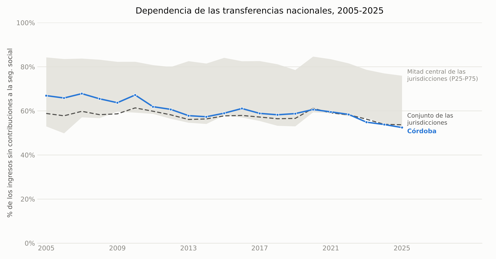

# Coparticipación federal: el caso de Córdoba

[](https://github.com/llorenzomagnano-sys/analisis-de-la-coparticipacion-federal-con-foco-en-cordoba/actions/workflows/ci.yml)

Análisis de datos del régimen de coparticipación federal de impuestos en Argentina, con foco en la provincia de Córdoba: cuánto recibe, si recibe en proporción a lo que aporta, qué pasa si cae la recaudación nacional, cuánto depende de esa plata y cómo se compara con las demás provincias.

> **Si no usás GitHub, empezá por acá**
>
> - **Esta página es el resumen completo.** Todo se puede leer acá, con los gráficos explicados uno por uno, sin descargar ni instalar nada.
> - **Para el análisis detallado de cada tema**, hacé clic en el notebook correspondiente de la tabla [Los cinco núcleos](#los-cinco-núcleos). GitHub lo muestra como un documento con texto, tablas y gráficos. Si en vez del documento aparece un mensaje de error, recargá la página: a veces GitHub tarda en mostrar los notebooks.
> - **El simulador se usa desde el navegador**: [abrir el simulador](https://llorenzomagnano-sys.github.io/analisis-de-la-coparticipacion-federal-con-foco-en-cordoba/simulador/).
> - **Los datos** están en la carpeta `data/`. Los archivos `.csv` se ven como tabla al hacer clic. Para bajar todo el proyecto: botón verde **Code**, arriba de la lista de archivos, y después **Download ZIP**.
> - No hace falta saber programar para leer el trabajo. El código está para quien quiera verificar de dónde sale cada número.

## De qué trata

La Nación cobra los impuestos más importantes del país, como el IVA y Ganancias. Por la Ley 23.548, de 1988, reparte una parte de lo que recauda entre las 23 provincias y la Ciudad de Buenos Aires (CABA), con porcentajes fijos para cada una (los *coeficientes*). Eso es la **coparticipación federal**. Para Córdoba es algo más de la mitad de lo que recauda en total.

La coparticipación aparece todo el tiempo en la agenda económica, con gobernadores que reclaman y discusiones sobre los coeficientes, pero casi nunca se explica con números concretos y trazables. Armé este repositorio para entender cómo funciona el reparto en la práctica, tomando a Córdoba como caso de estudio. De dónde sale cada dato, qué supuestos tomé y dónde flaquean queda documentado a la vista, no escondido en un anexo.

### Qué busca responder

1. ¿Cuánto recibió Córdoba desde 2003, descontada la inflación, y es mucho o poco en relación con su población y con la economía? ([Núcleo 1](notebooks/01_serie_historica.ipynb))
2. ¿Recibe en proporción a lo que pesa en la economía del país? ¿Y cuánto se lleva Nación de su producción sin repartirlo? ([Núcleo 2](notebooks/02_aporte_vs_recibo.ipynb))
3. Si la recaudación nacional cae, ¿cuánto pierde Córdoba? ([Núcleo 3](notebooks/03_simulador_sensibilidad.ipynb))
4. ¿Qué parte de las cuentas de Córdoba depende de la coparticipación, y es mucho comparado con otras provincias? ([Núcleo 4](notebooks/04_dependencia_fiscal_cordoba.ipynb))
5. ¿Cómo le fue a cada una de las 24 jurisdicciones, y por qué difieren? ([Núcleo 5](notebooks/05_comparacion_provincias.ipynb))

### Qué no busca explicar

- **Las transferencias discrecionales.** El trabajo mide las transferencias **automáticas** de la Ley 23.548: las que el Banco Nación gira a diario a cada provincia según su coeficiente, sin que nadie decida cada envío. Deja afuera las **no automáticas**, que Nación decide caso por caso: Aportes del Tesoro Nacional (ATN), convenios, obras y programas. Esas solo aparecen en la comparación entre provincias del Núcleo 4, y para Córdoba son chicas: el 3,4% de sus ingresos en 2025.
- **Otros regímenes automáticos y el gasto nacional directo.** Quedan afuera otros fondos que se reparten por leyes propias (IVA de la Ley 23.966, Bienes Personales, combustibles), los subsidios y obras que Nación paga directamente en cada provincia y la previsión social.
- **Si el reparto es justo.** Comparar lo que una provincia aporta con lo que recibe mide cuánto redistribuye el régimen, que está diseñado para eso. Si está bien o mal depende de con qué se lo compare: necesidades, costos de proveer servicios o capacidad de recaudar.
- **Pronósticos.** El simulador calcula qué pasaría ante una caída de la recaudación, pero no predice cuánto va a caer.
- **Cómo gasta cada provincia,** y qué pasaba antes de 2003, porque no hay datos de montos por provincia para esos años.

## Principales hallazgos

- **Córdoba recibe hoy lo mismo que hace diez años.** En pesos de 2025, su coparticipación llegó a un máximo de $5,42 billones en 2022 y cerró 2025 en $4,74 billones, más o menos el nivel de 2016. Desde 2004 se multiplicó por 2,1, y por habitante por 1,6. Contra 2003 el múltiplo es 3,1, pero exagera: 2003 es el piso de la crisis de 2001-2002 y solo en 2004 la serie subió 50%. Por habitante, el máximo fue en 2018 y 2025 está 17% por debajo.
- **La coparticipación creció más que la economía, y no por la inflación.** Para las 24 jurisdicciones juntas pasó de 4,9% del PIB en 2004 a 6,7% en 2025. La mayor parte del crecimiento se explica porque creció la economía (×1,53). El resto vino de una recaudación más alta en relación al PIB (×1,26) y de reglas que les dieron a las provincias una parte más grande de esa recaudación (×1,09, sobre todo por la devolución del 15% que se descontaba para la ANSES). Medida con el deflactor del PIB en vez del IPC, la serie da prácticamente lo mismo: no hay ilusión monetaria.
- **Dentro de la coparticipación, Córdoba recibe lo que pesa.** Se lleva el 8,58% de lo que se reparte entre provincias y produce el 8,57% del PBG. Por habitante, recibe exactamente el promedio del país. Las que reciben mucho menos que su peso económico son CABA (−17,5 pp) y Buenos Aires (−10,7 pp); las que más reciben en relación a su PBG, Chaco, Formosa y Tucumán (cerca de +3 pp cada una).
- **Frente a la Nación, Córdoba no es neutral.** Las retenciones que se cobran sobre su producción, que no se coparticipan, equivalen según mi estimación al 31% de su coparticipación en 2024 (23% con una estimación más baja). En 2008 la superaron. Sumando 2003-2024, equivalen al 59% de todo lo que recibió por coparticipación.
- **Una caída de la recaudación nacional golpea a todas las provincias por igual en porcentaje.** Calibrado con la caída de comienzos de 2026 que informó IARAF (~6,3%), el simulador estima que Córdoba pierde unos $120.100 millones en un cuatrimestre. Lo que efectivamente perdió fue un 10% más ($134.100 millones). Lo que cambia la gravedad del golpe es cuánto depende cada provincia de esa plata.
- **Córdoba depende menos de Nación que la mayoría de las provincias, y casi solo de transferencias automáticas.** La coparticipación es el 53,1% de su recaudación total (52,0% en 2015, máximo de 57,6% en 2023). Medido sobre todo el presupuesto, las transferencias nacionales son el 52,4% de sus ingresos: sexta menos dependiente de 23, contra una mediana de 66%. De eso, solo 3,4 puntos son transferencias discrecionales, así que el recorte de 2024, que en el conjunto de las provincias las bajó de 7,5% a 2,2% de los ingresos, casi no la afectó.
- **Entre provincias, lo que separa a unas de otras es la población, no la ley.** Como los coeficientes son fijos, el monto real de 22 de las 24 creció casi igual desde 2004 (entre ×2,07 y ×2,14). Por habitante, en cambio, va de ×1,10 en Tierra del Fuego a ×1,98 en CABA, según cuánto creció la población de cada una. Los grandes cambios en el reparto vinieron de cambios de reglas: el Fondo del Conurbano, el coeficiente de CABA y el Consenso Fiscal. La compensación del Consenso Fiscal va en un 56% a Buenos Aires, y por eso Córdoba recibe 0,29 puntos menos que su coeficiente: unos $157.100 millones en 2025.

## Los cinco núcleos

| Núcleo | Pregunta | Notebook |
|---|---|---|
| 1 | ¿Cuánto recibió Córdoba desde 2003, y es mucho o poco? | [`01_serie_historica.ipynb`](notebooks/01_serie_historica.ipynb) |
| 2 | ¿Recibe en proporción a lo que aporta? | [`02_aporte_vs_recibo.ipynb`](notebooks/02_aporte_vs_recibo.ipynb) |
| 3 | ¿Cuánto pierde si cae la recaudación nacional? | [`03_simulador_sensibilidad.ipynb`](notebooks/03_simulador_sensibilidad.ipynb) |
| 4 | ¿Cuánto depende de la coparticipación? | [`04_dependencia_fiscal_cordoba.ipynb`](notebooks/04_dependencia_fiscal_cordoba.ipynb) |
| 5 | ¿Cómo les fue a las 24 jurisdicciones? | [`05_comparacion_provincias.ipynb`](notebooks/05_comparacion_provincias.ipynb) |

La metodología completa (fuentes, supuestos y limitaciones de cada núcleo) está en [`docs/methodology.md`](docs/methodology.md).

## Los gráficos, uno por uno

### Núcleo 1 — Cuánto recibió Córdoba


**Qué muestra:** lo que recibió Córdoba cada año, en pesos de 2025.
**Qué mirar:** la coparticipación sube y baja con la economía, porque depende de lo que se recauda. Las caídas coinciden con las crisis: 2009 (crisis internacional, −7%), 2019-2020 (recesión y pandemia, −7% y −8%) y 2023-2024 (sequía y recesión, −5% y −8%). En 2016 Córdoba sube aunque el total de las provincias casi no crece: es el fallo de la Corte Suprema que le dejó de descontar el 15% para la ANSES.


**Qué muestra:** lo que recibió por habitante Córdoba, comparada con Santa Fe, Mendoza y Buenos Aires.
**Qué mirar:** la provincia que más recibe en total, Buenos Aires, es la que menos recibe por persona. Su salto de 2017-2019 es la vuelta del Fondo del Conurbano con el Consenso Fiscal. Córdoba creció menos que Santa Fe por habitante porque su población creció más (27% contra 19%).


**Qué muestra:** el total de las 24 jurisdicciones por habitante (izquierda) y como porcentaje del PIB (derecha).
**Qué mirar:** como % del PIB subió de 4,9% a 6,7%, sobre todo entre 2016 y 2020 por la devolución del 15% de la ANSES. El máximo de 2020 (7,5%) no es que las provincias recibieran más: el PIB cayó más que la coparticipación. En 2024 la caída por habitante (−9%) es mucho mayor que como % del PIB (−2%), porque los precios al consumidor subieron más que el resto de los precios de la economía.

### Núcleo 2 — Lo que aporta y lo que recibe


**Qué muestra:** para cada jurisdicción, la porción del reparto que recibe menos su peso en la economía, en puntos porcentuales. Azul: recibe más que su peso; rojo: menos.
**Qué mirar:** Córdoba está en cero, recibe exactamente lo que pesa. El régimen redistribuye desde CABA y Buenos Aires hacia las provincias del norte. En el caso de CABA la brecha está agrandada, porque muchas empresas que producen en todo el país pagan impuestos donde tienen la sede.


**Qué muestra:** la coparticipación que recibe Córdoba (azul) y las retenciones que se cobran sobre su producción (naranja; la sombra va hasta la estimación más baja), en pesos de 2025.
**Qué mirar:** las retenciones dependen de las alícuotas, de los precios y de la cosecha. Tocan su máximo en 2008 (precios récord), caen a un piso en 2016-2018 tras eliminarse para casi todos los productos, saltan en 2019 cuando vuelven a cobrarse a todas las exportaciones y se desploman en 2023 con la sequía.

### Núcleo 3 — Qué pasa si cae la recaudación


**Qué muestra:** cuánto pierde cada jurisdicción en el primer cuatrimestre de 2026 con una caída de 6,3% de la recaudación coparticipable.
**Qué mirar:** el largo de cada barra solo refleja el tamaño del coeficiente. En porcentaje, todas pierden lo mismo.


**[Probar el simulador en el navegador →](https://llorenzomagnano-sys.github.io/analisis-de-la-coparticipacion-federal-con-foco-en-cordoba/simulador/)** Se elige una caída (o suba) de la recaudación y muestra cuánto pierde Córdoba en pesos y como % de su recaudación total. Usa los datos de 2025 de este repositorio; el detalle con las 24 jurisdicciones está en el notebook.

### Núcleo 4 — Cuánto depende Córdoba de la coparticipación


**Qué muestra:** qué parte de lo que recauda Córdoba en total (lo propio más lo que llega de Nación) es coparticipación.
**Qué mirar:** sube de 52% a casi 58% entre 2015 y 2023 y baja a 53% en 2025. El gráfico siguiente explica por qué.


**Qué muestra:** la recaudación propia de Córdoba (Ingresos Brutos, Inmobiliario, Automotor, Sellos) y la coparticipación, en pesos de 2025.
**Qué mirar:** la recaudación propia cayó 20% entre 2017 y 2020 y no se recuperó hasta 2025, mientras la coparticipación sí se recuperó. Por eso subió la dependencia. En 2025 la recaudación propia creció 16% y la dependencia bajó.


**Qué muestra:** qué parte de los ingresos de cada jurisdicción viene de Nación en 2025. Azul oscuro: transferencias automáticas (coparticipación y otros regímenes por ley). Celeste: transferencias mayormente discrecionales.
**Qué mirar:** Córdoba está entre las menos dependientes (52,4%), y casi todo lo que recibe es automático. En La Rioja, Chaco, Formosa, Corrientes y Catamarca, lo que llega de Nación pasa el 80% de los ingresos. Las contribuciones a la seguridad social quedan afuera de la cuenta, porque solo las registran las provincias que tienen caja de jubilaciones propia.



**Qué muestra:** la misma medida desde 2005, para Córdoba, el conjunto de las 24 y la franja donde está la mitad de las jurisdicciones.
**Qué mirar:** Córdoba pasó de 66,9% en 2005 a 52,4% en 2025. Dos quiebres: en 2020 la dependencia de todas sube por la pandemia, y en 2024 baja porque Nación recortó las transferencias discrecionales.

### Núcleo 5 — Las 24 jurisdicciones


**Qué muestra:** cada punto es una jurisdicción. Hacia la derecha, más creció su población entre 2004 y 2025; hacia arriba, más creció lo que recibe por habitante.
**Qué mirar:** los puntos forman casi una línea. Las provincias que más crecieron en población (Tierra del Fuego, Santa Cruz, Neuquén) son las que menos mejoraron por habitante, porque la ley no tiene ningún componente que siga a la población.


**Qué muestra:** cuánto ganó o perdió cada jurisdicción en su porción del reparto, en puntos porcentuales contra 2003.
**Qué mirar:** casi todas las líneas están en cero. Los movimientos grandes son cambios de reglas. Buenos Aires perdió 5 puntos hasta 2016 con el Fondo del Conurbano congelado y los recuperó con el Consenso Fiscal. CABA subió en 2016 con el traspaso de la Policía Federal y volvió a bajar en 2020-2021.


**Qué muestra:** lo que recibió cada jurisdicción por habitante en 2022 (año del censo), dividido por el promedio del país.
**Qué mirar:** cuanto menos población, más recibe por habitante. Tierra del Fuego y Catamarca reciben casi tres veces el promedio; Buenos Aires, 0,59 veces y CABA, 0,34. Córdoba está justo en el promedio.

## Cronología: los hechos detrás de los quiebres

| Año | Qué pasó | Dónde se ve |
|---|---|---|
| 1988 | Ley 23.548: los coeficientes de reparto, que siguen vigentes. | Todos los núcleos |
| 1992 | Las provincias aceptan que se descuente el 15% de la masa para financiar la ANSES. | Núcleos 1 y 5 |
| 2002 | Vuelven las retenciones a las exportaciones, tras la devaluación. | Núcleo 2 |
| 2003-2004 | Salida de la crisis de 2001-2002: la coparticipación real sube casi 50% en un año. | Núcleo 1 |
| 2008 | Precios récord de los granos y conflicto por la Resolución 125 (retenciones móviles). | Núcleo 2 |
| 2009 | Crisis financiera internacional. | Núcleo 1 |
| 2015 | Fallos de la Corte Suprema: Córdoba, Santa Fe y San Luis dejan de pagar el 15% de la ANSES. En diciembre se eliminan las retenciones a casi todos los productos, salvo la soja. | Núcleos 1, 2 y 5 |
| 2016 | Acuerdo para devolverles el 15% a las demás provincias, de a 3 puntos por año hasta 2020. El Decreto 194/2016 sube el coeficiente de CABA por el traspaso de la Policía Federal. | Núcleos 1 y 5 |
| 2018 | Consenso Fiscal: termina el Fondo del Conurbano congelado y Buenos Aires recibe una compensación. Crisis cambiaria. Desde septiembre, retenciones a todas las exportaciones. | Núcleos 1, 2, 4 y 5 |
| 2020 | Pandemia. Nación baja el coeficiente de CABA (Decreto 735/2020 y Ley 27.606). | Núcleos 1, 4 y 5 |
| 2022 | Máximo de la coparticipación real. Cautelar de la Corte Suprema que le suma a CABA un 1,55% por fuera de la serie. | Núcleos 1 y 5 |
| 2023 | Sequía, la más fuerte en décadas. | Núcleos 1 y 2 |
| 2024 | Recesión con inflación muy alta. Recorte de las transferencias discrecionales a las provincias. | Núcleos 1 y 4 |
| 2026 | Caída de la recaudación nacional en el primer cuatrimestre (IARAF). | Núcleo 3 |

## Simulador interactivo

El Núcleo 3 tiene un simulador interactivo (slider de `ipywidgets`) dentro de `notebooks/03_simulador_sensibilidad.ipynb`, más la [versión web](https://llorenzomagnano-sys.github.io/analisis-de-la-coparticipacion-federal-con-foco-en-cordoba/simulador/), que se usa sin instalar nada. Elegí `ipywidgets` en vez de una app Streamlit para que todo el proyecto se pudiera reproducir desde los notebooks sin depender de un servidor. La lógica (`scripts/simulator.py`) está separada y sin dependencias de notebook, así que la versión web (`docs/simulador/index.html`) es esa misma fórmula en JavaScript. El GIF de arriba se genera con `scripts/build_demo_gif.py`.

## Cómo está organizado el repositorio

| Carpeta o archivo | Qué hay | Para quién |
|---|---|---|
| `README.md` (esta página) | Resumen, hallazgos y todos los gráficos explicados. | Cualquiera |
| `notebooks/` | Un documento por núcleo, con el análisis completo: texto, tablas y gráficos. | Cualquiera |
| `docs/methodology.md` | Fuentes, decisiones y limitaciones de cada núcleo, en detalle. | Quien quiera revisar el método |
| `output/figures/` | Los gráficos, en imágenes PNG. | Cualquiera |
| `data/raw/` | Los datos originales, tal como se obtuvieron. Nunca se editan a mano. Trazabilidad de cada archivo en [`data/raw/README.md`](data/raw/README.md). | Quien quiera verificar las fuentes |
| `data/processed/` | Los datos limpios que usan los notebooks, en CSV. | Quien quiera usar los datos |
| `scripts/` | El código que procesa los datos, el simulador y los tests. | Quien programa |
| `docs/simulador/` | El simulador web, publicado con GitHub Pages. | Cualquiera |
| `run_all.py` | Corre todo el proyecto de punta a punta con un solo comando. | Quien programa |

## Fuentes de datos

| Fuente | Organismo | Núcleo(s) |
|---|---|---|
| [Coparticipación / Recursos de Origen Nacional (RON)](https://www.argentina.gob.ar/economia/sechacienda/asuntosprovinciales/ron) | Secretaría de Hacienda, Ministerio de Economía de la Nación | 1, 3, 4, 5 |
| [Índice de Precios al Consumidor, 2016-2025](https://www.indec.gob.ar/ftp/cuadros/economia/serie_ipc_divisiones.csv) | INDEC | 1 |
| Índice de Precios al Consumidor, 2003-2015 (archivo obtenido en forma directa, sin URL pública verificada; en el repo solo las tasas usadas) | Fundación Norte y Sur / Orlando J. Ferreres | 1 |
| Producto Bruto Geográfico por provincia (`Jurisdiccion_52sectores.xlsx`, descargado a mano, sin URL verificada) | CEPAL, sobre metodología base de INDEC | 2 |
| Índices de distribución de la coparticipación federal (`indices_copa_2018.pdf`, planilla de febrero de 2018, descargada a mano) | No figura en el documento (menciona instrucciones de la Secretaría de Hacienda al BNA) | 2, 3, 4, 5 |
| Recaudación provincial (`serie_recaudacion_provincial.xlsx`, sin URL pública estable) | Dirección General de Rentas de Córdoba | 4 |
| [Caída de la recaudación nacional en el primer cuatrimestre de 2026](https://www.iaraf.org/index.php/13-areas-de-estudio/area-fiscal/723-informe-economico-2026-05-05) (escenario de referencia del simulador) | IARAF | 3 |
| [Población por jurisdicción, Censo 2022 (resultados definitivos)](https://www.indec.gob.ar/ftp/cuadros/poblacion/c2022_tp_est_c1.xlsx) | INDEC | 1, 5 |
| [Población por provincia 2001 y 2010 (Censo 2010, Tomo 1, Cuadro 8; transcripta)](https://www.indec.gob.ar/ftp/cuadros/poblacion/censo2010_tomo1.pdf) | INDEC | 1, 5 |
| [PIB nominal y a precios de 2004 (oferta y demanda globales)](https://www.indec.gob.ar/ftp/cuadros/economia/sh_oferta_demanda_09_26.xls) | INDEC | 1 |
| [Ejecución presupuestaria provincial, esquema ahorro-inversión 2005-2025](https://www.argentina.gob.ar/sites/default/files/serie_aif-apnf-2025.xlsx) | Dirección Nacional de Coordinación Fiscal con las Provincias, Ministerio de Economía | 4 |
| [Derechos de exportación, serie anual](https://apis.datos.gob.ar/series/api/series/?ids=142.1_DEREC_2001_A_20&format=csv) (API de datos.gob.ar) | Secretaría de Hacienda | 2 |
| Exportaciones por provincia y rubro (API de datos.gob.ar, ids `350.1_*`; URL completa en `data/raw/exportaciones/_metadata.json`) | INDEC | 2 |

Ninguna de estas fuentes tiene una licencia restrictiva conocida para este tipo de análisis, pero no todas tienen una URL pública verificada de origen. De la compilación de Ferreres no versiono el archivo completo, solo las 14 tasas de variación anual que usa el empalme. El detalle de cómo conseguí cada archivo, con qué alcance temporal y qué limitaciones tiene, está en [`data/raw/README.md`](data/raw/README.md) y en [`docs/methodology.md`](docs/methodology.md).

**Atribución**: la serie de precios 2003-2015 usada en el Núcleo 1 se basa en la compilación histórica de series económicas de Argentina realizada por **Orlando J. Ferreres** para la **Fundación Norte y Sur**, conocido por su obra de referencia *"Dos siglos de Economía Argentina"*. La uso acá solo como insumo — un índice de precios empalmado con fuentes oficiales, con el detalle en la metodología — y no reclamo ninguna autoría sobre la compilación original.

## Cómo correr el proyecto (para quien programa)

```bash
# Clonar el repositorio
git clone https://github.com/llorenzomagnano-sys/analisis-de-la-coparticipacion-federal-con-foco-en-cordoba.git
cd analisis-de-la-coparticipacion-federal-con-foco-en-cordoba

# Crear y activar un entorno virtual
python -m venv venv
source venv/bin/activate      # En Windows: venv\Scripts\activate

# Instalar dependencias
pip install -r requirements.txt

# Correr todo el pipeline: procesamiento de los 5 núcleos + tests + regeneración
# de los 5 notebooks (con sus gráficos). data/raw/ ya viene poblada en el repo.
python run_all.py
```

Para explorar de forma interactiva en vez de solo regenerar: `jupyter notebook` y abrir cualquiera de los notebooks de `notebooks/`. Para correr solo los tests (simulador y chequeos de consistencia de los datos procesados): `pytest scripts/`. Cada cambio que se sube al repositorio corre este mismo pipeline en GitHub Actions (la insignia "CI" de arriba), que además controla que los datos procesados sean exactamente los que generan los scripts.

## Limitaciones metodológicas (resumen)

Cada una de estas se documenta en detalle, con la decisión tomada y su razón, en [`docs/methodology.md`](docs/methodology.md):

- **Núcleo 1** no llega a 1990 (la idea original) porque no existe una fuente de montos nominales de coparticipación por provincia para 1990-2002; el rango quedó en 2003-2025. El tramo 2003-2016 depende de un IPC empalmado con una fuente privada (Ferreres/Norte y Sur), porque el IPC oficial de 2007-2015 quedó desacreditado por la intervención del INDEC y el actual recién arranca en diciembre de 2016. Hacienda cambió varias veces la forma de informar la coparticipación (bruta o neta del Financiamiento Educativo, Ganancias aparte hasta 2017); la serie las unifica en una sola definición, que para Córdoba coincide con la de la propia provincia en todos los años 2015-2025. La población entre censos es una interpolación, y la de 2023-2025 extiende la tasa 2010-2022 (probablemente la sobreestima un poco). El PIB del INDEC arranca en 2004, así que el % del PIB no cubre 2003.
- **Núcleo 2** usa el PBG como proxy del aporte tributario real, que tiene un problema de atribución geográfica conocido: las empresas suelen tributar donde tienen sede fiscal, no donde generan la actividad económica. Eso probablemente infla el aporte de CABA y subestima el de provincias productivas como Córdoba. Además, la fuente está a precios constantes de 2004, así que las participaciones de 2024 usan los precios relativos de ese año. La comparación mide cuánto redistribuye el régimen, no si es justo, y deja afuera el gasto nacional directo, las transferencias no automáticas y la previsión social. Las retenciones de Córdoba son una estimación de orden de magnitud: reparten el total nacional según su peso en las exportaciones agropecuarias, sin alícuotas por producto.
- **Núcleo 3** es un modelo lineal y proporcional, calibrado con una sola cifra pública (un cuatrimestre de recaudación). La caída total de $5,1 billones está verificada en el informe de IARAF; los $1,4 billones que pierden las provincias no los pude verificar en el original (otra fuente publicó $1,3 billones, que daría un impacto ~7% menor). Contrastado con lo que cobró Córdoba en ese cuatrimestre, subestima la pérdida en alrededor de 10%. Es una calculadora de escenarios, no un modelo de pronóstico.
- **Núcleo 4** mide la coparticipación contra la recaudación total de Córdoba (lo que administra la Dirección General de Rentas más los recursos de origen nacional), no contra los ingresos corrientes del presupuesto: quedan afuera, por ejemplo, los aportes a la Caja de Jubilaciones, las transferencias no automáticas y lo que recaudan otros organismos como EPEC. Contra los ingresos corrientes, los recursos de origen nacional son el 42,9%. La comparación entre provincias usa ejecuciones presupuestarias provisorias; La Pampa no tiene datos de 2025. Las transferencias corrientes y de capital no vienen abiertas por tipo, así que no puedo separar las pocas que siguen alguna regla fija de las discrecionales. El indicador de sensibilidad es una simplificación de primera ronda: no modela ninguna respuesta de política provincial ante una caída de ingresos.
- **Núcleo 5** usa la población estimada entre censos para el crecimiento por habitante 2004-2025, y la del Censo 2022 para comparar el nivel por habitante contra el promedio (no hay en el repositorio proyecciones oficiales por provincia basadas en ese censo). El 1,55% adicional que Nación transfiere a CABA por la cautelar de 2022 no aparece en la serie de Hacienda que uso.

## Licencia

Este proyecto está bajo licencia MIT. Ver [LICENSE](LICENSE) para más detalles. Los datos de `data/raw/` conservan la licencia/términos de sus fuentes originales (estadísticas públicas u organismos oficiales); no se redistribuyen bajo la licencia MIT del código.

## Autor

**Lorenzo Magnano**

El código lo escribí con asistencia de herramientas de IA. Las preguntas, la elección y el control de las fuentes y los criterios metodológicos son míos.
